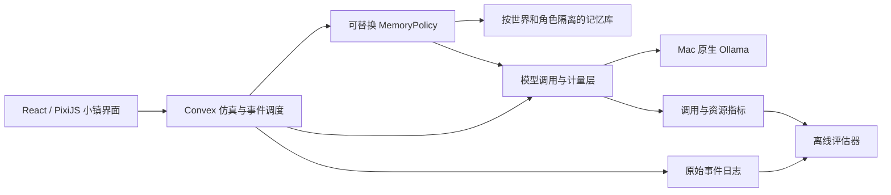

# 架构设计

状态：设计已确定，运行组件尚未接入。

## 组件与数据流

第一版保留 Convex 的存储和向量检索，减少同时更换框架、数据库、算法带来的归因困难。新增策略通过适配器接入。Ollama 在 Mac 原生运行，Convex 在 Docker 中运行，前端开发服务器在宿主机运行。

## 上游落点

| 位置 | 当前上游用途 | 计划改动 |
| --- | --- | --- |
| `convex/util/llm.ts` | 模型配置、生成、embedding、重试 | usage 采集、用途标签、attempt、超时和预算 |
| `convex/agent/memory.ts` | 对话摘要、重要性、检索与反思 | 策略适配、来源链、预算和隔离审计 |
| `convex/agent/schema.ts` | 记忆字段 | 版本、类型、作用域、有效时间与来源 |
| `convex/constants.ts` | 检索数量、对话频率等参数 | 参数进入实验配置，保持 baseline 可还原 |
| `convex/init.ts` | 创建世界与角色 | 固定人数和可导出的初始状态 |
| `convex/crons.ts` | 定时与空闲暂停 | 实验模式的停止条件与后台运行控制 |
| `data/characters.ts` | 角色初始描述 | 固定场景版本，禁止跨组随意改动 |

这些路径来自前期上游调研。接入固定 commit 时逐一确认，不直接按文件名批量修改。

## 运行边界

- `worldId` 是实验世界边界，`agentId` 是角色可见性边界；两者都属于记忆和缓存键。
- 原始事件库用于追踪和回放，不等于角色可查询的记忆库。
- 角色只能把实际观察到的事件写入自己的记忆。共享公告属于单独的显式范围。
- 单个模型服务可以服务多个角色；不共享角色提示词、会话状态或私有记忆。
- 生成与向量模型分别固定摘要。切换 embedding 模型必须建立新索引版本，即使维度相同也不能混用。

## 时间与可复现性

AI Town 的实时互动会受推理速度、排队和空闲暂停影响。第一轮算法比较采用固定工作负载：相同的观察、查询和任务数量，剥离模型速度导致的行为数量变化。

在线小镇作为第二层验证，分别记录 wall time、世界时间、有效事件和互动数量。不能仅固定运行 30 分钟就声称两组完成了相同工作。可控逻辑时钟与无界面执行器属于 P2/P4 待实现内容，不是现成功能。

## 数据和版本

正式运行至少保存：研究代码 commit、上游 commit、dirty diff、锁文件校验和、容器镜像 digest、Ollama 版本、模型 digest、Modelfile、硬件信息、数据集与初始状态校验和。

`ai-town/` 计划使用独立 checkout/fork。根仓库保存研究规范与实验工具，上游工作区保存集成代码。正式结果必须同时记录两者版本，不能仅记录根仓库 commit。

## 第一版观测边界

推理耗时与端到端耗时分开；embedding、摘要、评分、反思、对话分别记账。Mac 的统一内存与 Docker 内存可能口径重叠，不直接相加冒充独立 GPU 与 CPU 使用量。未直接测量电力时不输出能耗节省百分比。
